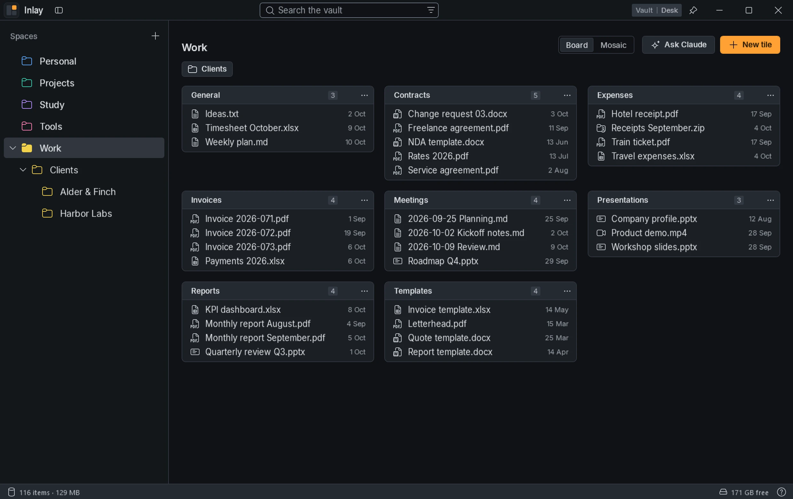
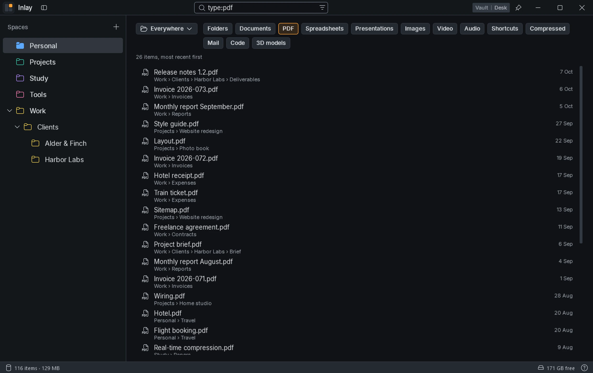
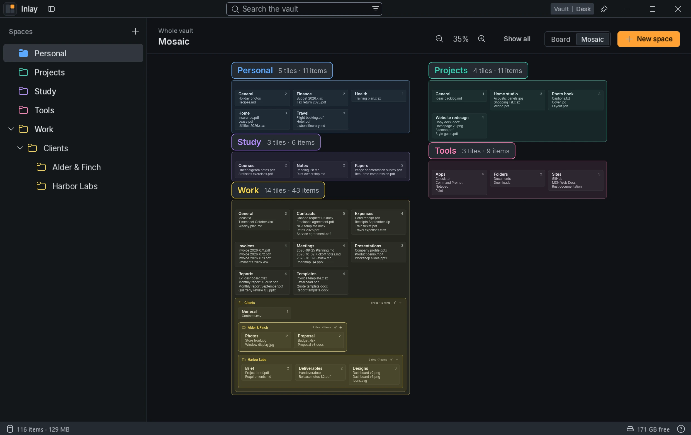
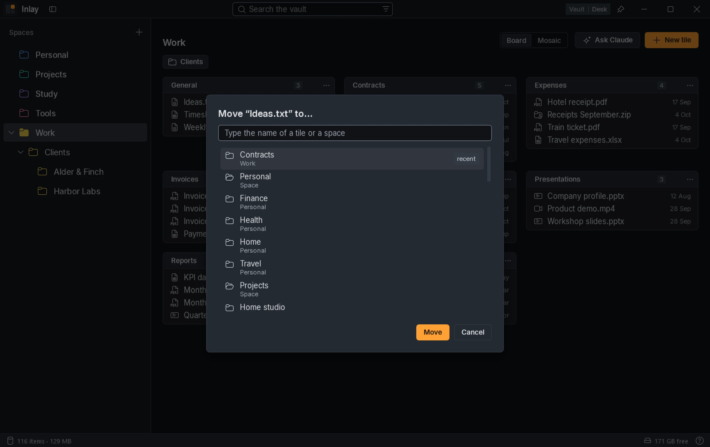

# Inlay

**A desk you call up with a shortcut, in place of the Windows desktop.**

[](https://github.com/caste9612/Inlay/releases/latest)

[](LICENSE)

I used the desktop as a workbench, but with many windows open, and even more with GlazeWM, it is always
covered. As a way to organise things it is also fragile: one level and no search. Inlay is a desk that comes
up with `Alt+E` over everything, with the files in a vault of real folders divided into spaces, search, undo
and the Mosaic of the whole vault.



## Download

Download `Inlay-win-Setup.exe` from the [latest release](https://github.com/caste9612/Inlay/releases/latest)
and run it. The first time, Inlay asks for the vault: create a new one or use a folder you already have.

- **Windows 11** with the .NET 10 Desktop Runtime; the installer downloads it if it is missing.
- Inlay installs for the current user, without administrator rights, in `%LOCALAPPDATA%\Inlay`. It starts with
  Windows and adds itself to the **Send to** menu of Explorer; both can be turned off in **Settings**.
- It updates itself from these releases: when a new version is ready, **Update to X** appears at the top, and
  one click restarts Inlay into it; otherwise it installs when you quit.
- The installer is not signed, so Windows may warn about it: choose **More info**, then **Run anyway**.
- Uninstalling leaves the vault and your files where they are.

## What it does

- **Spaces and tiles**: the spaces and the tiles on their board are real folders, so the vault stays tidy and
  usable from Explorer even without the app. The files directly in a space are in its **General** tile.
- **Works like the desktop**: select, open, rename, drag, cut, copy and paste with the same gestures and
  shortcuts as Explorer, also to and from other apps. Deleting always goes through the Recycle Bin, and
  `Ctrl+Z` undoes moves, copies, renames and deletions, several times in a row.
- **Search**: type anywhere to search the whole vault, with filters by file type and by space, as buttons or
  typed: `type:pdf`, `in:Work`.



- **Mosaic**: the whole vault on a canvas you can zoom, with one zone for each space; the **+** next to the name
  of a zone adds a tile to it.



- **Move to… and Send to Inlay**: files go to a tile or a space chosen by name, from Inlay or from the **Send to**
  menu of Explorer.



- **Claude in a folder**: right-click a space, a tile or a folder, and **Ask Claude about this folder** opens
  Claude Code there, in Windows Terminal, with a prompt you choose in **Settings** › **Claude**; **Open Claude
  here** starts an empty chat. It needs Claude Code installed.

The complete guide, gesture by gesture, is in [docs/uso.md](docs/uso.md), in Italian like the other documents;
the interface is in English.

## Build from source

You need Windows 11 with the .NET 10 SDK.

```powershell
dotnet build Inlay.slnx
dotnet test
.\scripts\New-DemoArchive.ps1 -Path D:\DemoVault
dotnet run --project src/Inlay.App -- --archive D:\DemoVault
```

`--archive` uses that vault for this run only. If an Inlay is already running, a second one passes it the
command and closes: quit the installed one first (**Quit** in its tray menu). `--render-preview` draws the
panel into an image without opening any window ([docs/test.md](docs/test.md)).

How the code is built is in [docs/](docs/README.md); the idea, the rules of the vault and the plan of the
versions in [PROGETTO.md](PROGETTO.md). Built with C#, .NET 10 and WPF, on the Brace design system, with
Velopack for the installer and the updates.

## License

[MIT](LICENSE), including the files of the Brace design system in `src/Inlay.App/Brace/`.
